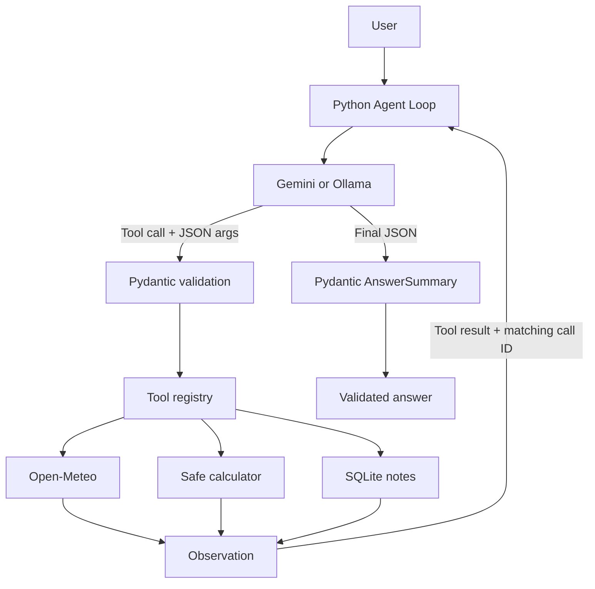

# Tool-Using Assistant — DawoodTech Agentic AI, Week 1

A provider-switchable Python terminal assistant built around a **hand-written LLM agent loop**. The model selects tools, Python validates and executes them, observations return to the model, and the final response is validated with Pydantic.

> **Security:** This repository contains no API keys. Put credentials in a local `.env` file. Never commit that file or publish secrets.

## Features

- Gemini via Google's OpenAI-compatible API, or Ollama via its OpenAI-compatible local endpoint.
- Three required tool categories:
  - **Weather:** current conditions from Open-Meteo.
  - **Calculator:** restricted AST arithmetic; no Python `eval()`.
  - **SQLite notes:** save and search notes.
- Four callable functions: `get_weather`, `calculate`, `save_note`, and `search_notes`.
- Pydantic-generated JSON schemas for tool arguments.
- Hand-written agent loop with tool-call IDs, tool execution, observations, error handling, and a configurable step limit.
- Final Pydantic `AnswerSummary` with `answer`, `tools_used`, and `confidence`.
- Fifteen live evaluation prompts, three-run capture, and system-prompt comparison scripts.
- Deterministic offline mock demo for testing application plumbing without an API key.

## Architecture



The model does not execute Python. It requests a named function and JSON arguments; the application validates and runs the function, then sends the result back with the corresponding tool-call ID.

## Requirements

- Python 3.11+
- [uv](https://docs.astral.sh/uv/)
- One provider: [Gemini API key](https://aistudio.google.com/app/apikey) or local [Ollama](https://ollama.com/)

## Windows setup — Gemini

Open PowerShell in the repository directory:

```powershell
uv sync --extra dev
Copy-Item .env.example .env
notepad .env
```

Set your private key in `.env`:

```dotenv
LLM_PROVIDER=gemini
LLM_API_KEY=YOUR_PRIVATE_GEMINI_KEY
LLM_BASE_URL=https://generativelanguage.googleapis.com/v1beta/openai/
LLM_MODEL=gemini-3.5-flash-lite
```

Then run:

```powershell
uv run agentic-assistant
```

Try these prompts:

- What is the current weather in Multan, Pakistan?
- Calculate (235 * 17) + 918.
- Remember that the Week 1 assignment is due on 23 November 2026.
- Find my note about the Week 1 assignment.

The validated response has this shape:

```json
{
  "answer": "The requested result...",
  "tools_used": ["calculate"],
  "confidence": 0.95
}
```

The application replaces the model's `tools_used` field with the names of tools actually executed.

## Alternative setup — Ollama

Install Ollama and pull a tool-capable model. A small starting point is Qwen 3 4B:

```powershell
ollama pull qwen3:4b
Copy-Item .env.example .env
```

Set these values in `.env`:

```dotenv
LLM_PROVIDER=ollama
LLM_API_KEY=ollama
OLLAMA_BASE_URL=http://localhost:11434/v1
LLM_MODEL=qwen3:4b
```

Keep Ollama running, then execute `uv run agentic-assistant`. The client omits `tool_choice` for Ollama compatibility.

## Offline demo — no API key

```powershell
uv run agentic-assistant --demo
```

This uses a deterministic mock provider to exercise calculator and SQLite flows. **It is not a live Gemini/Ollama inference and must not be presented as such.**

## Week 1 learning notes

The learning-phase summaries, workflows-versus-agents reading notes, Gemini OpenAI-compatibility feature notes, and ReAct reason/act/observe explanation are in [docs/learning-notes.md](docs/learning-notes.md). Detailed provider compatibility notes are in [docs/gemini-compatibility.md](docs/gemini-compatibility.md).

## Tests and live evidence

Run unit tests:

```powershell
uv run pytest
```

Run all 15 questions against your configured live provider:

```powershell
uv run python scripts/run_eval.py
```

This generates `tests/results.json` and `tests/results.md`, recording the actual tools executed. The expected tools in `tests/questions.md` are expectations, not proof of execution. Review answers and tool results, not just PASS counts.

Capture three real provider runs (weather, calculator, SQLite):

The script also inserts the actual timestamped provider outputs into the README under a generated section, satisfying the task's three-run log requirement. It never fabricates logs; the section appears only after a successful live capture.

```powershell
uv run python scripts/capture_live_runs.py
```

Compare three system prompts on the same user request:

```powershell
uv run python scripts/compare_prompts.py
```

These scripts require a configured live provider. Reviewed evaluation, run-log, and prompt-comparison evidence from 17 November 2026 is versioned in this repository. Local secrets, SQLite data, virtual environments, and raw agent logs remain excluded.

## Project layout

```text
.
├── .env.example
├── .gitignore
├── README.md
├── pyproject.toml
├── src/agentic_assistant/
│   ├── agent.py
│   ├── cli.py
│   ├── config.py
│   ├── mock_provider.py
│   ├── models.py
│   └── tools.py
├── scripts/
│   ├── capture_live_runs.py
│   ├── compare_prompts.py
│   └── run_eval.py
├── tests/
│   ├── questions.json
│   ├── questions.md
│   ├── test_agent_loop.py
│   ├── test_tools.py
│   └── test_weather.py
└── docs/
    ├── demo-recording-guide.md
    ├── gemini-compatibility.md
    ├── implementation-report.md
    ├── learning-notes.md
    └── prompt-comparison.md
```

## Configuration

| Variable | Purpose | Default |
|---|---|---|
| `LLM_PROVIDER` | `gemini` or `ollama` | `gemini` |
| `LLM_API_KEY` | Private provider key | Required for Gemini |
| `LLM_BASE_URL` | Gemini compatible endpoint | Google endpoint |
| `OLLAMA_BASE_URL` | Local Ollama endpoint | `http://localhost:11434/v1` |
| `LLM_MODEL` | Provider model | `gemini-3.5-flash-lite` / `qwen3:4b` |
| `LLM_TEMPERATURE` | Sampling control | `0.2` |
| `LLM_MAX_TOKENS` | Output token limit | `900` |
| `MAX_AGENT_STEPS` | Agent loop bound | `6` |
| `SQLITE_PATH` | Notes database | `.data/notes.db` |
| `LOG_PATH` | Runtime log | `logs/agent.log` |

## Security and reliability

- `.env`, virtual environments, local SQLite data, runtime logs, and generated provider outputs are excluded by `.gitignore`.
- Never commit API keys, personal notes, private prompts, or screenshots containing credentials.
- Pydantic validates tool arguments before execution.
- Calculator parses a restricted AST and does not execute arbitrary Python.
- SQLite uses parameterized SQL.
- Network calls have timeouts.
- The OpenAI client retries transient provider errors up to four times using its backoff policy; persistent HTTP 503 responses can still occur during provider-capacity incidents.
- The OpenAI-compatible client retries transient provider failures up to four times; persistent 503 responses can still occur during Google service-capacity incidents.
- The agent loop has a configurable maximum step count.
- Final output is parsed and validated with Pydantic.

## Learning references

- [Gemini API — OpenAI compatibility](https://ai.google.dev/gemini-api/docs/openai)
- [Gemini API — Function calling](https://ai.google.dev/gemini-api/docs/function-calling)
- [Anthropic — Building effective agents](https://www.anthropic.com/research/building-effective-agents)
- [Yao et al. — ReAct paper](https://arxiv.org/abs/2210.03629)
- [Open-Meteo API](https://open-meteo.com/en/docs)
- [Ollama OpenAI compatibility](https://github.com/ollama/ollama/blob/main/docs/api/openai-compatibility.mdx)

## Internship submission checklist

- [x] Configure Gemini and complete a genuine live request using gemini-3.5-flash-lite.
- [x] Run all 15 live evaluation questions: **15/15 expected-tool checks passed** (tests/results.md).
- [x] Run the three-prompt comparison and record observations (docs/prompt-comparison-results.md).
- [x] Capture three real provider runs: weather, calculator, and SQLite notes (logs/live_runs.md).
- [ ] Record a terminal demonstration with the API key hidden.
- [x] Publish source code and reviewed evidence in a public GitHub repository.
- [ ] Submit the repository and demo video URLs through TaskDesk.

## Verified live evidence — 17 November 2026

- **Provider:** Google Gemini OpenAI-compatible API
- **Model:** gemini-3.5-flash-lite
- **Local automated tests:** 14 passed on the Windows environment.
- **Live evaluation:** 15/15 expected-tool selection checks passed; no request errors were recorded. See tests/results.md and tests/results.json.
- **Live tool demonstrations:** weather (get_weather), arithmetic (calculate), and note creation (save_note) completed through the model-driven agent loop. See logs/live_runs.md.
- **Prompt comparison:** three system prompts were tested against the same BFS/DFS request. See docs/prompt-comparison-results.md.

The 15/15 result measures expected tool selection, not comprehensive factual correctness. Review the recorded answers before relying on them. The screen-recorded demo and TaskDesk submission are still outstanding.

<!-- BEGIN GENERATED LIVE RUN LOGS -->
## Live provider run logs

> Actual runs against the configured provider. These are live Gemini responses, not offline mock-provider output.

- **Provider:** gemini
- **Model:** gemini-3.5-flash-lite
- **Timestamp:** 2026-11-17T20:31:45+05:00

## Run 1 — Weather

**User request:** What is the current weather in Multan, Pakistan?

**Validated output:**

~~~json
{
  "answer": "The current weather in Multan, Pakistan is 23.3°C with clear skies (0% cloud cover), relative humidity at 30%, wind speed at 11.2 km/h from the east-northeast, and no precipitation.",
  "tools_used": ["get_weather"],
  "confidence": 1.0
}
~~~

## Run 2 — Calculator

**User request:** Calculate (235 * 17) + 918.

**Validated output:**

~~~json
{
  "answer": "4913",
  "tools_used": ["calculate"],
  "confidence": 1.0
}
~~~

## Run 3 — SQLite notes

**User request:** Save a note titled 'DawoodTech live demo' with content 'The agent loop executed on a live provider'.

**Validated output:**

~~~json
{
  "answer": "Successfully saved the note titled 'DawoodTech live demo'.",
  "tools_used": ["save_note"],
  "confidence": 1.0
}
~~~
<!-- END GENERATED LIVE RUN LOGS -->
